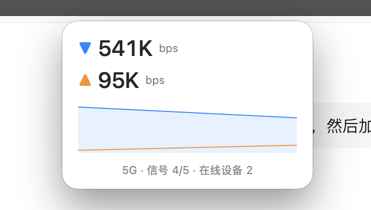

# F50Speed

macOS 菜单栏实时网速工具 · macOS menu-bar real-time speed monitor for the ZTE F50 5G hotspot

**🌐 语言选择 / Language：** 点击下方标题展开对应语言 / Click a title below to expand that language

---

<details open>
<summary><b>🇨🇳 简体中文</b>（点击展开/收起）</summary>

一个 macOS 菜单栏实时网速工具，直连中兴 F50 5G 热点（192.168.0.1）的免登录接口读取上下行速率；F50 不在身边时，自动回退到读取 Mac 自身网卡速率。单文件 Swift 源码，零依赖，本地编译即用。


## 功能

- **菜单栏实时速率**：▼下行 ▲上行，上下两行或左右并排可切
- **悬浮窗**：大号数字 + 最近速率曲线，可拖到任意位置
- **两种速率来源**：
  - F50 免登录接口（`flux_realtime_tx_thrpt / rx_thrpt`），显示 5G 信号、在线设备数
  - F50 不可达时自动改用本机默认网卡计数差值，连其他 Wi-Fi 也能用
- **1 秒级刷新**：默认 1 秒，可切 2 / 5 秒
- **Mbps / MB/s 单位切换**
- **中英双语界面**，一键切换
- **开机自动启动**
- 无 Dock 图标、无外部依赖、无网络权限弹窗


## 系统要求

- macOS 13 Ventura 或更高
- 与 F50 在同一网络（或任何网络——会自动切换到本机速率）

## 构建

```bash
git clone https://github.com/mickey-hsu/F50Speed.git
cd F50Speed
./build.sh
```

`build.sh` 用 `swiftc` 编译 `Sources/main.swift` 并打包成 `F50Speed.app`。也可以手动编译：

```bash
swiftc -O -swift-version 5 Sources/main.swift -o F50Speed
```

## 安装

把 `F50Speed.app` 拖进「应用程序」文件夹，双击运行；在菜单栏图标菜单里勾选「开机自动启动」。

## 使用

点击菜单栏图标打开菜单：

| 菜单 | 说明 |
|---|---|
| 状态行 | 网络类型 · 信号 · 在线设备 |
| 刷新间隔 | 1 秒（默认）/ 2 秒 / 5 秒 |
| 速率单位 | Mbps（网络速率）/ MB/s（下载速度） |
| 菜单栏布局 | 上下显示 / 左右显示 |
| 显示悬浮窗 | 开关速率悬浮窗 |
| 开机自动启动 | 注册/取消登录项 |
| 语言 | 中文 / English |
| 打开 F50 管理页 | 浏览器打开 192.168.0.1 |

所有偏好即时生效并本地保存。

## 原理

F50 的 Web 后台在未登录状态下通过以下接口暴露实时速率：

```
http://192.168.0.1/goform/goform_get_cmd_process?cmd=flux_realtime_tx_thrpt,flux_realtime_rx_thrpt,network_type,network_signalbar,wifi_access_sta_num&multi_data=1
```

返回 JSON，速率单位为 bps。回退模式用 `getifaddrs` 读取默认路由接口的字节计数，按采样间隔求差值换算 bps，Wi-Fi 名称通过 `networksetup -getairportnetwork` 获取。

> 注意：本工具仅适用于你自己的 F50 所在的局域网，接口行为随固件版本可能不同。

## 命令行参数

- `--float`：启动时直接打开悬浮窗
- `--probe`：取一次 F50 数据并打印，然后退出
- `--probe-local`：采样本机网卡 2 秒计算速率并打印，然后退出

</details>

---

<details>
<summary><b>🇬🇧 English</b> (click to expand/collapse)</summary>

A macOS menu-bar speed monitor that reads real-time up/down throughput directly from the ZTE F50 5G hotspot (192.168.0.1) via its login-free API. When the F50 is unreachable, it automatically falls back to measuring the Mac's own network interface. Single-file Swift source, zero dependencies, build and run.


## Features

- **Real-time speeds in the menu bar**: ▼down ▲up, stacked or side-by-side layout
- **Floating window**: big numbers + recent throughput sparkline, draggable anywhere
- **Two speed sources**:
  - F50 login-free API (`flux_realtime_tx_thrpt / rx_thrpt`), plus 5G signal and client count
  - Falls back to the Mac's primary interface counters when the F50 is away
- **Second-level refresh**: 1s default, 2s / 5s optional
- **Mbps / MB/s unit toggle**
- **Bilingual UI** (Chinese / English), one-click switch
- **Launch at login**
- No Dock icon, no dependencies, no network permission prompts



## Requirements

- macOS 13 Ventura or later
- On the same network as the F50 (or any network — it falls back automatically)

## Build

```bash
git clone https://github.com/mickey-hsu/F50Speed.git
cd F50Speed
./build.sh
```

`build.sh` compiles `Sources/main.swift` with `swiftc` and assembles `F50Speed.app`. Or compile manually:

```bash
swiftc -O -swift-version 5 Sources/main.swift -o F50Speed
```

## Install

Drag `F50Speed.app` to Applications and launch it. Enable "Launch at login" from the menu-bar menu.

## Usage

Click the menu-bar icon:

| Menu | Description |
|---|---|
| Status line | Network type, signal, client count |
| Refresh interval | 1s (default) / 2s / 5s |
| Speed unit | Mbps (line rate) / MB/s (byte rate) |
| Menu bar layout | Stacked / side by side |
| Show floating window | Toggle the floating window |
| Launch at login | Register/unregister login item |
| Language | 中文 / English |
| Open F50 admin | Open 192.168.0.1 in browser |

All preferences apply instantly and persist locally.

## How it works

The F50 exposes real-time throughput without login at:

```
http://192.168.0.1/goform/goform_get_cmd_process?cmd=flux_realtime_tx_thrpt,flux_realtime_rx_thrpt,network_type,network_signalbar,wifi_access_sta_num&multi_data=1
```

It returns JSON with speeds in bps. Fallback mode samples the default-route interface byte counters via `getifaddrs` and differentiates over the sampling interval; the Wi-Fi SSID comes from `networksetup -getairportnetwork`.

> Note: this tool is intended for your own F50's local network; the API behavior may vary by firmware version.

## Command-line arguments

- `--float`: open the floating window at launch
- `--probe`: fetch once from the F50, print, exit
- `--probe-local`: sample the local interface for 2s, print computed rates, exit

</details>

---

## License

[MIT](LICENSE)
